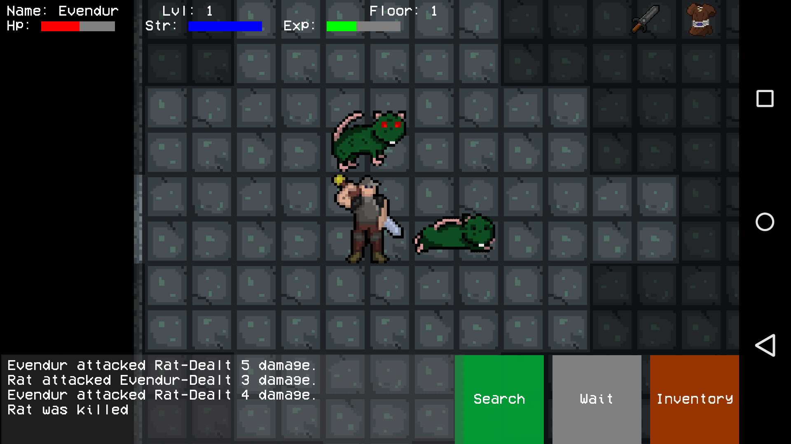
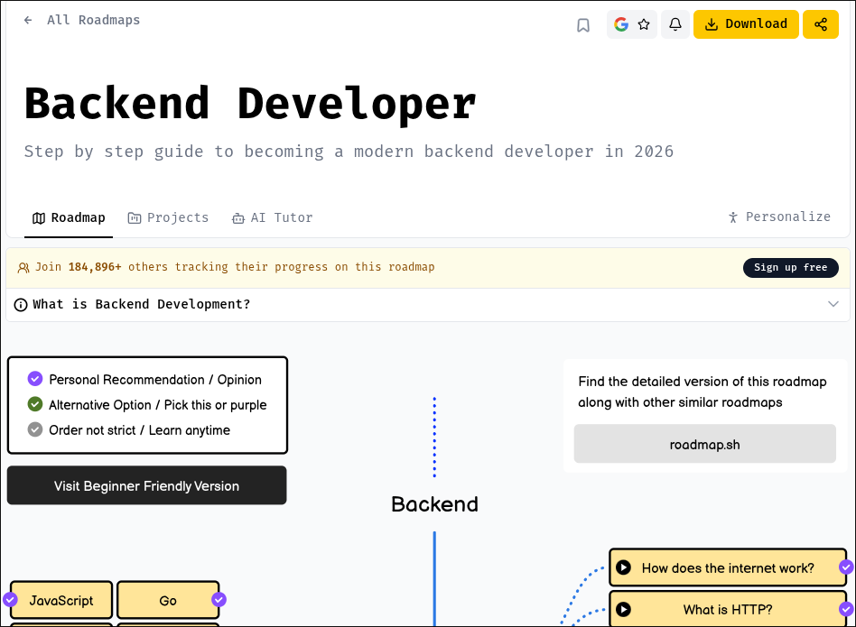
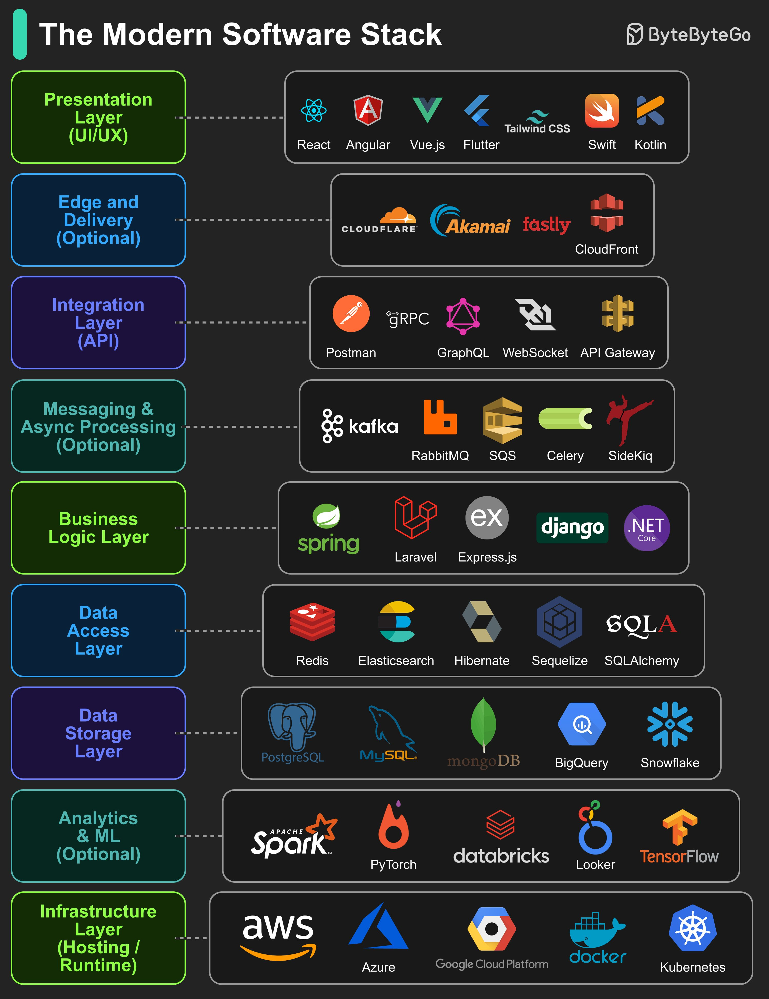

Introduction - About me
---

- From Aalborg
- Graduated from AAU in 2015 with a Masters in Computer Science

<!-- end_slide -->

What is this going to be about??
---
Yes..AI, but

<!-- pause -->

# Two parts
<!-- pause -->

- Reflections of working as a developer over the last 10 years
<!-- pause -->
- The future of software development?

<!--end_slide -->

Part 1: Quick timeline
---

- Graduated AAU in 2015
- Worked in games industry till 2022
- Worked various roles mainly backend development

<!-- end_slide -->

Starting Out - Games
---
Been making games by myself throughout university

<!-- pause -->
2d games using game libraries rather than game engine

--- 

<!-- pause -->
Meaning...
# No editor, everything is written in code
<!-- end_slide -->

Starting Out - Games
---

But meanwhile something else was very hyped by other students
<!-- pause -->

<!-- end_slide -->

Unity
---

Never liked it

I liked to program!

I didn't want to learn Unity only things

--- 

<!-- pause -->

But it was an easy way for to make something cool quickly for many

Now everyone could make games*

<!-- end_slide -->

Unity Slop
---
Low effort Unity games flood steam 

Unity games become synonymous with low effort games
<!-- end_slide -->

Getting a job after university
---

# Luck!

but also..
<!-- pause -->
--- 
Being a programmer that can make games

Rather than a game developer who can program

<!-- pause -->

# Focusing on my programming skills paid off!

<!-- end_slide -->

Being a Game Developer
---
Chasing what is fun

Good code? Not really

--- 

<!-- pause -->

# Cursed code
- 1000 line function for whole gameplay loop
- Anything the player wont see, is not important
- No code review, gotta go fast

<!-- end_slide -->

After games
---
Started being passionate about backend development
# Designing architecture over experimentation
---

<!-- pause -->

Landing first job was really rough in the start

<!-- pause -->

I had been focusing on making cool stuff

<!-- pause -->

--> Rather than honing my craft

<!-- end_slide -->

Honing my craft?
---

<!-- end_slide -->

Many ways to do things
---

<!-- end_slide -->

And then?
---

- Felt pretty confident in my skills

- Knew multiple tech stacks and multiple languages

- Can setup full backends up from scratch

<!-- end_slide -->

And then AI?
---
In 2026 things went fast

- Gemini - For design
- Copilot - For reviewing code
- Claude code - For generating code

<!-- pause -->

Human in the loop development
<!-- end_slide -->

Why AI is useful for me
---

- Helps me understand legacy codebases
- Vibecode tools quickly
- Identifying security issues

<!-- end_slide -->

Using AI professionally in 2026
---
# You are still responsible for the code!
- Why did you do it in this way?
- Why are you using this library

Software development is about trade-offs

<!-- pause -->
--> AI gives you the answer to your question

<!-- end_slide -->

Using AI professionally in 2026
---

Vibecoded projects start from scratch, e.g. `make gta 5 make no mistakes`

However...

--- 
<!-- pause -->
Companies have years of legacy code
- You have to deal with bad decisions made years ago
- Dependencies make modernization infeasible

<!-- pause -->
e.g. the banking world is stuck on millions of lines of cobol, can't just say rewrite into rust
<!-- end_slide -->

Part 2: The future
---
Have I spent all these years honing my craft to just babysit claude?

<!-- pause -->
At least it can feel like that, but now I can also focus on the fun part!
<!-- end_slide -->

Claude do this tedious stuff
---

AI can be seen as a step in a serious of advancements to help programmers

<!-- pause -->

---

*Languages:* I don't need to worry about memory management

*IDE*: Generate boiler plate code

*AI*: Generate CRUD sql for users

<!-- end_slide -->

Humans as the architects
---

I can focus on the fun parts
- Algorithm design
- Brainstorm architecture
- Learn new things

<!-- end_slide -->

Software development is dead?
---
In my opinion:

--> Not for the foreseeable future

---
There will always be a human in the loop
- CEOs making 5 year plans
- Head of departments making 1 year plans
- Other managers making quartly plans

<!-- end_slide -->

Software development bottleneck
---
- For a long time it has not been coding, but rather humans in charge.
- Overworking have been a thing for a while
- Managers can't keep up with development speeds

<!-- end_slide -->

Summary
---
Making cool stuff vs craftmanship

# Anyone can make software now

So focus on the fundamentals to understand generated code

<!-- end_slide -->
Thank you!
---

Slides:

www.github.com/kralle333/aau-genai

